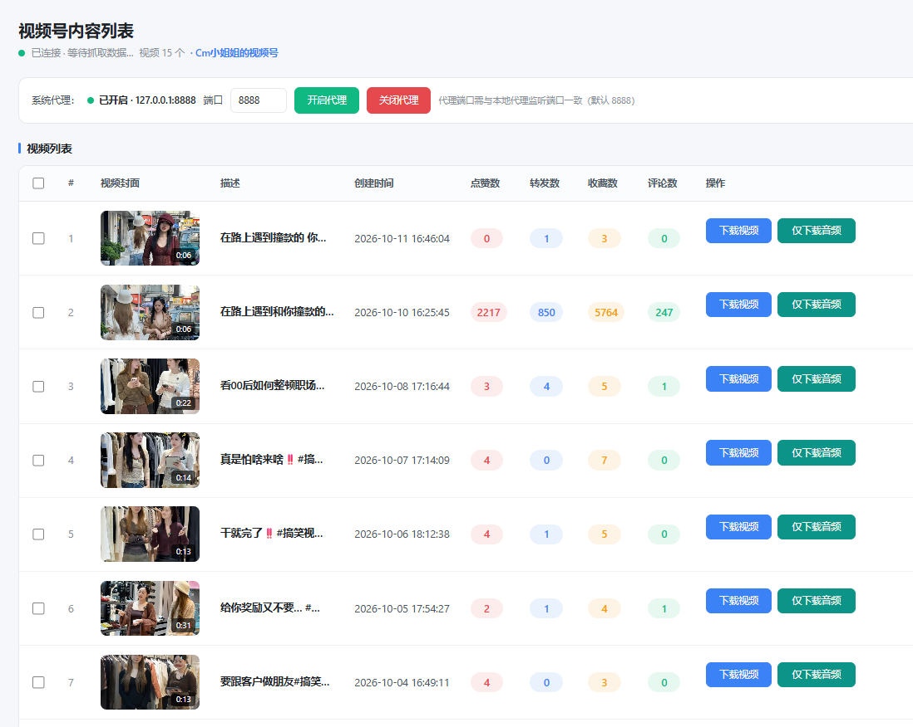
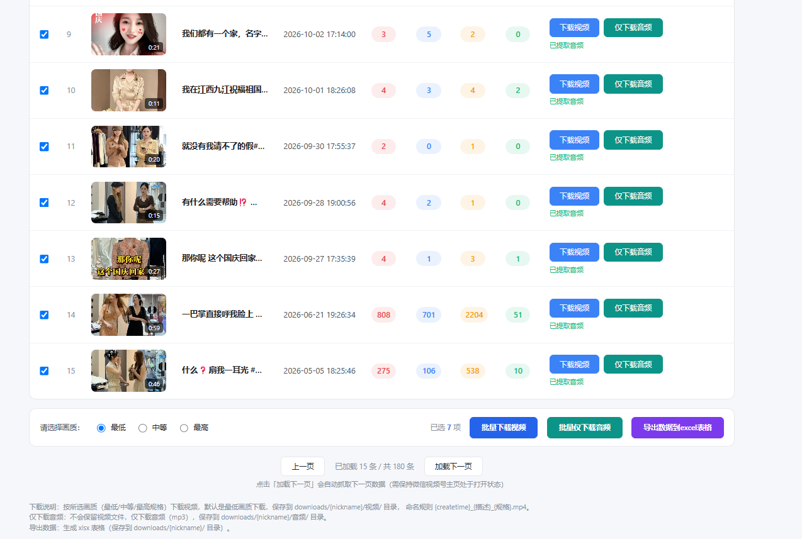
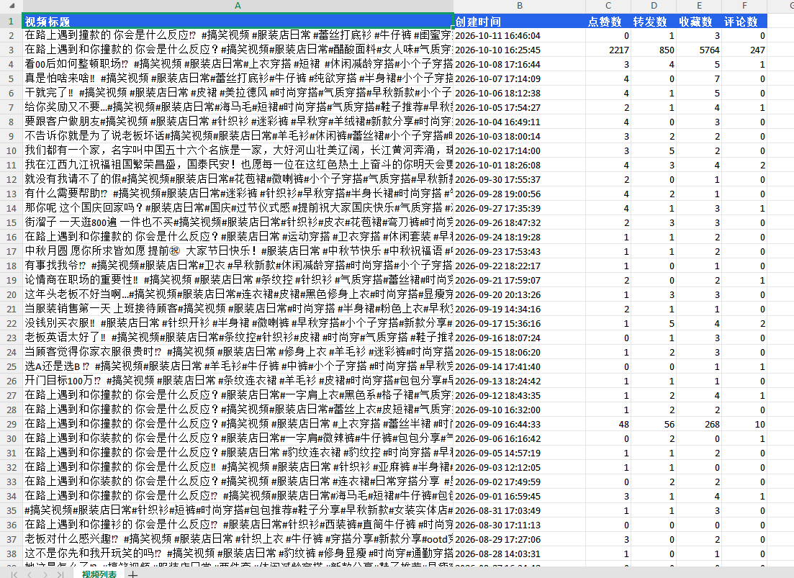

# wx-sph-downloader
【微信视频号下载工具】下载视频，提取音频，点赞数，转发数，收藏数，导出数据到excel表格

## ✨ 功能特性
- ✅ 视频号视频下载
- ✅ 视频音频单独提取
- ✅ 抓取作品元数据：点赞 / 转发 / 收藏数量
- ✅ 批量导出采集数据至 Excel
- ✅ 可视化操作界面

## 🖼️ 项目截图

## 📞 联系方式

> ⚠️ 免责声明
> 本工具仅供个人学习研究使用，请勿用于商用、侵权等违法场景。使用本工具产生的一切法律责任，由使用者自行承担。

## 📋 使用说明
1. 环境准备（后续补充）
2. 启动项目（后续补充）
3. 填入视频号链接，开始采集

## 📌 待开发
- [ ] 批量链接解析
- [ ] 自动分页抓取
